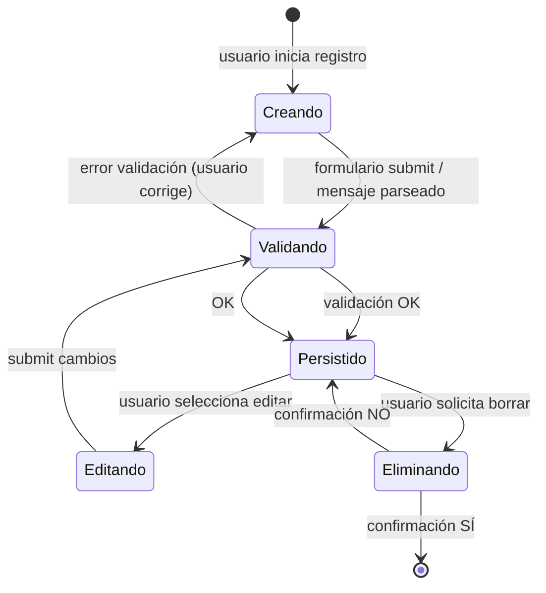

# Data Model: Núcleo de registro y consulta de movimientos

**Fecha**: 2026-10-18 | **Feature**: `001-registro-consulta-movimientos` | **Versión esquema**: 1

---

## Entidad: Movimiento

Representa un ingreso o gasto registrado por el usuario. Única entidad persistida en v1.

### Campos

| Campo | Tipo | Restricciones | Descripción |
|-------|------|---------------|-------------|
| `id` | `Uuid` (v4) | PK, generado al crear, inmutable | Identificador único global |
| `tipo` | `MovementType` | `NOT NULL`, `CHECK (ingreso\|gasto)` | Clasificación del movimiento |
| `monto_centavos` | `i64` | `NOT NULL`, `> 0` | Monto en centavos de COP (evita float); 1 COP = 1 centavo |
| `concepto` | `String` | `NOT NULL`, `1..200 chars`, `trim != ""` | Texto libre: "Almuerzo", "Pago de quincena" |
| `fecha` | `NaiveDate` | `NOT NULL`, `≤ today (local)` | Fecha del movimiento (zona horaria local) |
| `origen` | `MovementOrigin` | `NOT NULL`, `DEFAULT 'formulario'` | `formulario` \| `mensaje` — trazabilidad |
| `creado_en` | `DateTime<Local>` | `NOT NULL` | Timestamp de creación (ISO 8601 local) |
| `actualizado_en` | `DateTime<Local>` | `NOT NULL` | Timestamp de última edición (ISO 8601 local) |

### Enums

```rust
#[derive(Debug, Clone, Copy, PartialEq, Eq, Serialize, Deserialize)]
#[serde(rename_all = "lowercase")]
pub enum MovementType {
    Ingreso,
    Gasto,
}

#[derive(Debug, Clone, Copy, PartialEq, Eq, Serialize, Deserialize)]
#[serde(rename_all = "lowercase")]
pub enum MovementOrigin {
    Formulario,
    Mensaje,
}
```

### Reglas de validación (dominio)

1. **Monto**: entero positivo (`> 0`). Entrada usuario en COP (ej. `18000`) → almacenado como `18000` centavos. Sin decimales en COP.
2. **Concepto**: `trim()` no vacío, máx 200 chars. Requerido en ingresos y gastos (clarificación: obligatorio).
3. **Fecha**: `NaiveDate` (sin zona horaria). Al registrar/editar: fecha ≤ hoy (validación en UI y dominio). Fecha futura → rechazo (programar pagos fuera de MVP).
4. **Tipo**: inmutable tras creación (editar no permite cambiar ingreso↔gasto).
5. **Origen**: inmutable; informativo para analytics futuras.
6. **Timestamps**: `creado_en` inmutable; `actualizado_en` refresca en cada `update`.

### Esquema SQL (SQLite v1)

```sql
-- migrations/001_init.sql
CREATE TABLE movements (
    id            TEXT PRIMARY KEY,                    -- UUID v4
    tipo          TEXT NOT NULL CHECK(tipo IN ('ingreso','gasto')),
    monto_centavos INTEGER NOT NULL CHECK(monto_centavos > 0),
    concepto      TEXT NOT NULL CHECK(trim(concepto) != ''),
    fecha         TEXT NOT NULL,                       -- YYYY-MM-DD
    origen        TEXT NOT NULL CHECK(origen IN ('formulario','mensaje')) DEFAULT 'formulario',
    creado_en     TEXT NOT NULL,                       -- YYYY-MM-DDTHH:MM:SS
    actualizado_en TEXT NOT NULL                       -- YYYY-MM-DDTHH:MM:SS
);

CREATE INDEX idx_movements_fecha ON movements(fecha DESC, creado_en DESC);
CREATE INDEX idx_movements_tipo_fecha ON movements(tipo, fecha DESC);

PRAGMA user_version = 1;
```

**Notas**:
- `monto_centavos` = entero → precisión exacta, sin redondeo.
- `fecha` y timestamps como TEXT ISO 8601 → portable, ordenable lexicográficamente.
- Índices cubren: historial ordenado (fecha desc), filtro por tipo+fecha, resumen por rango.

---

## Vistas derivadas (no persistidas)

### ResumenPeríodo

```rust
#[derive(Debug, Clone, PartialEq, Eq)]
pub struct PeriodSummary {
    pub ingresos_centavos: i64,   // suma de monto_centavos donde tipo = ingreso
    pub gastos_centavos: i64,     // suma de monto_centavos donde tipo = gasto
    pub diferencia_centavos: i64, // ingresos - gastos (puede ser negativo)
    pub desde: Option<NaiveDate>,
    pub hasta: Option<NaiveDate>,
}
```

**Cálculo**: `SELECT SUM(CASE WHEN tipo='ingreso' THEN monto_centavos ELSE 0 END) AS ingresos, SUM(CASE WHEN tipo='gasto' THEN monto_centavos ELSE 0 END) AS gastos FROM movements WHERE fecha BETWEEN ? AND ?` (rangos inclusivos; `NULL` = sin filtro).

**Presentación**: Formato COP con separador de miles (`1.500.000`), signo `+` para ingresos, `−` para gastos, diferencia como "Balance registrado: $X". Nunca "dinero libre" ni "saldo bancario".

### Historial

Lista de `Movement` ordenada por:
1. `fecha DESC` (más reciente primero)
2. `creado_en DESC` (desempate dentro del mismo día = orden de registro)

Filtro opcional: `desde` / `hasta` (inclusive). Sin filtro = todos.

---

## Ciclo de vida (State Transitions)



**Transiciones válidas**:
- `Creando` → `Persistido` (save)
- `Persistido` ↔ `Editando` (edit → save)
- `Persistido` → `Eliminado` (delete + confirm)
- **No válido**: `Ingreso` ↔ `Gasto` (cambio de tipo), `Persistido` → `Creando`

---

## Reglas de negocio adicionales

| Regla | Dónde se aplica |
|-------|-----------------|
| Monto > 0 | Dominio (`Movement::new`), UI (input type=number min=1), Storage (CHECK) |
| Concepto obligatorio | Dominio, UI (required), Storage (CHECK) |
| Fecha ≤ hoy | Dominio, UI (max=today), Storage (validación en app) |
| Tipo inmutable | Dominio (no setter), UI (no editable), Storage (sin UPDATE tipo) |
| Confirmación al borrar | UI (diálogo), Storage (solo expone `delete(id)`) |
| Persistencia atómica | Storage (transacción SQLite) |
| Rango de fechas inclusivo | Storage (`query`, `summary`) |
| Orden por defecto: fecha desc, creado_en desc | Storage (`query`) |

---

## Migraciones futuras (esquema v2+)

| Versión | Cambio | Script |
|---------|--------|--------|
| 2 | Multi-moneda: `moneda TEXT NOT NULL DEFAULT 'COP'` | `002_add_currency.sql` |
| 3 | Cuenta/medio de pago: `cuenta_id TEXT REFERENCES accounts(id)` | `003_add_account.sql` |
| 4 | Categorías: `categoria_id TEXT REFERENCES categories(id)` | `004_add_category.sql` |
| 5 | Soft-delete: `eliminado_en TEXT NULL` + vista `active_movements` | `005_soft_delete.sql` |

Cada migración: `PRAGMA user_version = N` al final; test de roundtrip v1→vN.